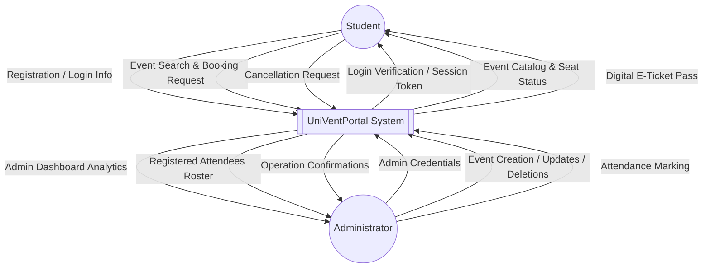
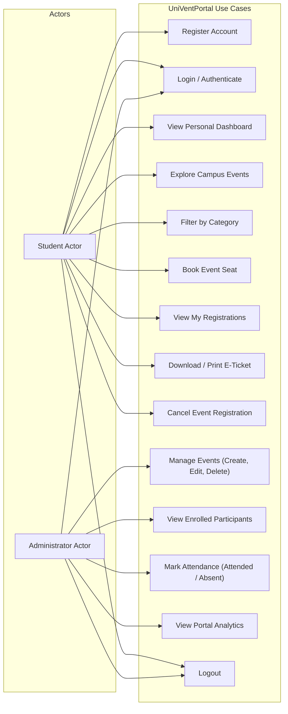
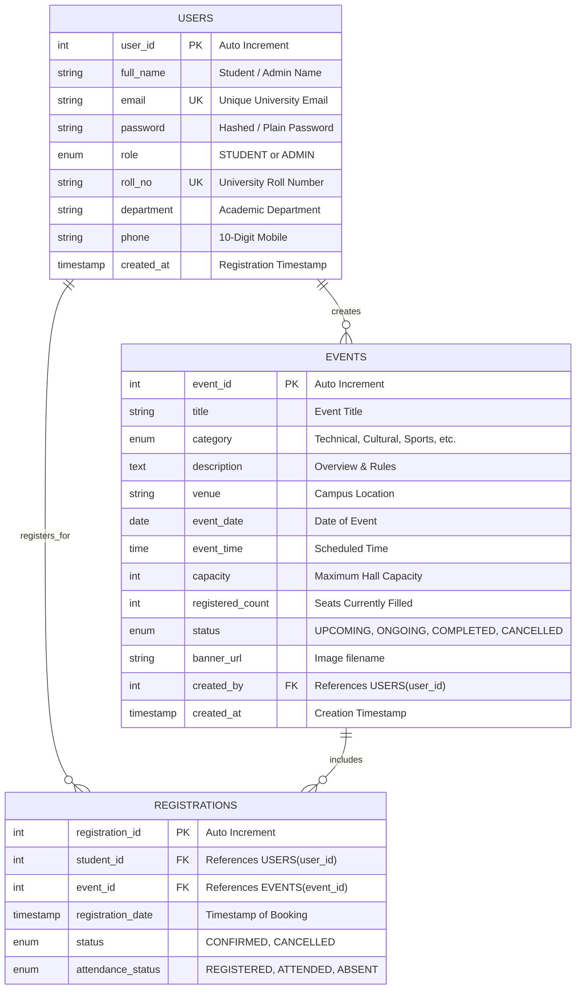

# ACADEMIC CASE STUDY & PROJECT REPORT

---

## **PROJECT TITLE**
# **University Campus Event and Student Activity Management Portal**
### *(UniVentPortal)*

---

**Course:** Master of Computer Applications (MCA) — 1st Semester  
**Specialization:** Data Science / Artificial Intelligence  
**Institution:** Chandigarh University, Mohali, Punjab  
**Subject:** Advanced Internet Programming (AIP)  
**Academic Year:** 2026  

---

## **TABLE OF CONTENTS**
1. [Abstract](#1-abstract)
2. [Introduction](#2-introduction)
3. [Problem Statement](#3-problem-statement)
4. [Project Objectives](#4-project-objectives)
5. [Existing System vs. Proposed System](#5-existing-system-vs-proposed-system)
6. [System Requirements Specification (SRS)](#6-system-requirements-specification-srs)
   - 6.1 Functional Requirements
   - 6.2 Non-Functional Requirements
7. [Technology Stack & Justification](#7-technology-stack--justification)
8. [System Architecture & Design](#8-system-architecture--design)
   - 8.1 3-Tier MVC Architecture
   - 8.2 Architectural Diagram
9. [Process Modeling](#9-process-modeling)
   - 9.1 Data Flow Diagram (DFD Level 0 — Context Level)
   - 9.2 Data Flow Diagram (DFD Level 1)
   - 9.3 Use Case Diagram
10. [Database Design & Data Modeling](#10-database-design--data-modeling)
    - 10.1 Entity-Relationship (ER) Diagram
    - 10.2 Database Schema & Data Dictionary
11. [Module Implementation & File Breakdown](#11-module-implementation--file-breakdown)
12. [User Interface Design & Screen Layouts](#12-user-interface-design--screen-layouts)
13. [Software Testing & Test Cases](#13-software-testing--test-cases)
14. [Results & Discussion](#14-results--discussion)
15. [Limitations of the System](#15-limitations-of-the-system)
16. [Future Enhancements](#16-future-enhancements)
17. [Conclusion](#17-conclusion)
18. [References](#18-references)
19. [Comprehensive Viva-Voce Questions & In-Depth Answers](#19-comprehensive-viva-voce-questions--in-depth-answers)

---

## **1. ABSTRACT**
In higher educational institutions such as Chandigarh University, vibrant campus life involves hundreds of academic symposiums, technical hackathons, cultural festivals, sports tournaments, and professional workshops conducted across multiple academic blocks throughout the academic year. Traditional paper circulars, noticeboards, and disconnected Google Forms suffer from acute limitations: lack of real-time seat availability tracking, frequent double bookings, manual attendance collation, and absence of a unified student activity ledger.

This case study presents the design, development, and deployment of the **University Campus Event and Student Activity Management Portal (`UniVentPortal`)**, an enterprise-standard web application implemented following the **Model-View-Controller (MVC Model 2)** architectural pattern. The system utilizes **HTML5, CSS3, and JavaScript** on the presentation layer, **Java Servlets and JavaServer Pages (JSP)** on the application/controller layer, and **MySQL** as the relational database tier executed over an **Apache Tomcat** web server. The portal provides dual-role access: a **Student Module** offering personalized dashboards, live category filtering, atomic seat reservation, cancellation management, and printable digital E-Ticket passes; and an **Admin Module** providing event lifecycle management (CRUD), real-time capacity tracking, attendance marking, and participation analytics. Rigorous validation, atomic database transactions (`COMMIT`/`ROLLBACK`), and secure session management guarantee data consistency and system integrity.

---

## **2. INTRODUCTION**
Modern internet programming principles emphasize modularity, responsiveness, secure client-server communication, and state preservation across stateless HTTP transactions. The subject **Advanced Internet Programming (AIP)** in the MCA curriculum focuses on mastering client-server architectures, HTTP methods (`GET` vs. `POST`), form validation, Servlet life-cycles, JSP compilation and execution, Session Management, and Database Connectivity via JDBC.

The **University Campus Event and Student Activity Management Portal** serves as a comprehensive culmination of these academic concepts. Rather than acting as a static informational website, `UniVentPortal` is an interactive, data-driven web application featuring:
- Asynchronous client-side validation paired with authoritative server-side sanitization.
- Stateless HTTP request handling transformed into stateful user experiences via `HttpSession`.
- Declarative security enforcement via `javax.servlet.Filter`.
- Atomic database concurrency controls avoiding overbooking in limited-capacity campus auditoriums.

---

## **3. PROBLEM STATEMENT**
Chandigarh University hosts tens of thousands of students across diverse faculties (Computing, Engineering, Business, Biotechnology, Media). Coordinating co-curricular activities currently encounters several operational bottlenecks:
1. **Information Fragmentation:** Event notices are scattered across departmental bulletin boards, WhatsApp groups, and social media, leading to missed registration deadlines.
2. **Overbooking & Capacity Chaos:** Manual registration forms (e.g., Google Forms) do not enforce dynamic capacity limits at the moment of submission, resulting in more registered students than the physical venue capacity.
3. **Absence of Student Participation History:** Students have no centralized dashboard to view events they have attended or registered for, hindering verification during semester co-curricular credit evaluations.
4. **Administrative Overhead:** Event organizers spend considerable manual labor tracking attendance lists, managing cancellations, and aggregating participation statistics across departments.

---

## **4. PROJECT OBJECTIVES**
The core objectives of the `UniVentPortal` project are:
1. **Centralized Digital Showcase:** Establish a unified, searchable, and filterable catalog of all campus events categorized by *Technical*, *Cultural*, *Sports*, *Workshops*, and *Seminars*.
2. **Atomic Self-Service Seat Booking:** Enable authenticated students to reserve seats with guaranteed concurrency control, preventing duplicate entries and capacity overshoots.
3. **Dynamic Participation Pass:** Generate instant digital E-Ticket passes with distinct ticket identifiers and student verification metadata.
4. **Cancellation & Seat Reclamation:** Allow students to cancel their registrations before the event, automatically restoring venue seat capacity in real time.
5. **Role-Based Administrative Control:** Equip university administrators with full CRUD capabilities over events, real-time participant roster downloads, attendance status logging, and departmental analytics.
6. **Academic Demonstration of AIP Core Concepts:** Implement client-server communication, HTTP method separation (`GET` for retrieval, `POST` for mutation), Servlet lifecycle, JSP custom presentation, session management, and JDBC transaction safety.

---

## **5. EXISTING SYSTEM VS. PROPOSED SYSTEM**

| Feature / Dimension | Existing System (Noticeboards / Forms) | Proposed System (UniVentPortal) |
| :--- | :--- | :--- |
| **User Interface** | Disparate forms, paper notices, flyers | Uniform, responsive, aesthetic web application |
| **Seat Allocation** | Manual count after form closure | Real-time atomic verification & seat counter |
| **Duplicate Registrations**| Common due to multiple form submissions | Prevented via composite database unique constraints |
| **Cancellation Management**| Students cannot cancel without emailing admin | One-click student self-cancellation with instant seat release |
| **Security & Privacy** | Public sheets often expose student phone numbers | Role-based authorization via Servlet Filters and password hashing |
| **Attendance Verification** | Manual paper signatures at the hall entrance | Centralized digital attendance marking (`ATTENDED`/`ABSENT`) |
| **Session Tracking** | None | Secure `HttpSession` management with 30-minute idle expiry |
| **Data Analytics** | Manual Excel pivot tables | Automated dashboard with category distribution & counters |

---

## **6. SYSTEM REQUIREMENTS SPECIFICATION (SRS)**

### **6.1 Functional Requirements**

#### **A. Student Module**
1. **Account Registration:** Students register by submitting their Full Name, University Roll Number, Email Address, Department, Phone Number, and Password with instant validation.
2. **Authentication (Sign In):** Secure login verifying credentials, creating an authenticated HTTP Session, and routing to the Student Dashboard.
3. **Student Dashboard:** Displays personal KPIs: total enrolled events, active upcoming campus events, recent registration history, and quick access to events.
4. **Browse & Filter Events:** Search activities by keyword (title/venue) and filter by categories: *Technical*, *Cultural*, *Sports*, *Workshop*, *Seminar*.
5. **Real-Time Seat Registration:** Allows registration for an open event with immediate confirmation or error alerts if the event is full or already booked.
6. **My Registrations History:** Tabular listing of all registered events showing dates, venues, status (`CONFIRMED`/`CANCELLED`), and attendance status.
7. **Digital E-Ticket Pass:** Interactive modal preview and printable ticket with unique reference ID (`#EV-XXXX`).
8. **Registration Cancellation:** Allows students to cancel confirmed seats, triggering automatic capacity decrement in the database.

#### **B. Administrator Module**
1. **Admin Authentication:** Restricted administrative access for Dean of Student Welfare / Event Coordinators.
2. **Analytics Dashboard:** Visual metric cards for Total Events Hosted, Upcoming Events, Total Registrations, and Student Accounts, alongside Category Distribution counters.
3. **Event Management (CRUD):**
   - **Create:** Add new events with Title, Category, Agenda, Venue, Date, Time, and Maximum Seat Capacity.
   - **Read:** Comprehensive event catalog displaying real-time occupancy percentages.
   - **Update:** Edit venue, timings, capacity, or event status (`UPCOMING`, `ONGOING`, `COMPLETED`, `CANCELLED`).
   - **Delete:** Remove events with cascading cleanup of associated registrations.
4. **Roster & Attendance Management:** View attendees filtered by event; update student attendance to `REGISTERED`, `ATTENDED`, or `ABSENT`.
5. **Student Directory:** View the master student roster, roll numbers, departments, and enrollment timestamps.

### **6.2 Non-Functional Requirements**
1. **Performance:** Sub-second response times for catalog browsing and seat registration queries under standard lab server loads.
2. **Data Consistency & Concurrency:** ACID transactions during seat booking prevent race conditions and overbooking.
3. **Security:** Passwords protected via hashing; URL endpoints under `/admin/*` and `/student/*` protected by `AuthenticationFilter`; session fixation mitigation on login; prevention of SQL Injection via `PreparedStatement`.
4. **Usability & Responsiveness:** Clean modern UI utilizing custom CSS grid and flexbox, rendering seamlessly across mobile devices, tablets, and desktop workstations.
5. **Maintainability:** Modular separation of concerns into JavaBeans (`model`), Data Access Objects (`dao`), Controllers (`controller`), Filters (`filter`), and View components (`JSP`).

---

## **7. TECHNOLOGY STACK & JUSTIFICATION**

### **7.1 Presentation Tier (Frontend)**
- **HTML5:** Semantic document structuring (`<header>`, `<nav>`, `<main>`, `<section>`, `<footer>`, `<form>`).
- **CSS3:** Custom stylesheet (`style.css`) using modern design tokens, CSS variables, gradient accents, responsive cards, data tables, and modal dialogs without bulky external frameworks.
- **JavaScript (ES6):** Client-side validation (`validation.js`) providing instant feedback before form submission, dynamic search filtering, and modal management.

### **7.2 Application Tier (Backend)**
- **Java Platform, Standard Edition (Java SE 8+):** Robust, type-safe, cross-platform runtime environment.
- **Java Servlets (Servlet API 3.1):** High-performance controller component handling HTTP request routing, parameters extraction, business logic coordination, and response dispatching.
- **JavaServer Pages (JSP 2.3):** Server-side view technology enabling clean presentation with embedded scriptlets, directives, and conditional rendering.
- **Servlet Filters:** Declarative interceptors enforcing authentication, authorization, and browser cache disabling (`Cache-Control: no-store`).

### **7.3 Persistence Tier (Database)**
- **MySQL Server 8.0:** High-speed relational database management system supporting InnoDB engine, foreign key constraints, and ACID transactions.
- **Java Database Connectivity (JDBC 4.2 Type-4 Driver):** Direct socket-based communication between the JVM and MySQL with `PreparedStatement` parameter binding.

### **7.4 Web Server & Container**
- **Apache Tomcat 9.0:** Industry-standard Java Servlet container and JSP engine providing HTTP request parsing, multi-threaded request processing, and session lifecycle management.

---

## **8. SYSTEM ARCHITECTURE & DESIGN**

### **8.1 3-Tier MVC Model 2 Architecture**
The system strictly enforces the **MVC Model 2** design pattern:
1. **Model:** Represents business data and persistence operations. Implemented via JavaBean POJOs (`User.java`, `Event.java`, `Registration.java`, `DashboardStats.java`) and DAOs (`UserDAO.java`, `EventDAO.java`, `RegistrationDAO.java`).
2. **View:** Presentation tier implemented using JSP pages (`index.jsp`, `dashboard.jsp`, `browse-events.jsp`, `my-registrations.jsp`, `manage-events.jsp`, etc.) styled with CSS3. Views never execute business queries directly; they receive processed attributes from the Controller.
3. **Controller:** Implemented via Java Servlets (`AuthServlet.java`, `StudentServlet.java`, `AdminServlet.java`, `EventServlet.java`). The controller acts as the central router: intercepting HTTP requests, calling DAOs to update or retrieve models, and forwarding control to JSPs via `RequestDispatcher.forward()`.

### **8.2 System Architecture Diagram**

```mermaid
graph TD
    subgraph Client Tier
        Browser["Web Browser (Student / Admin)"]
        HTML_CSS_JS["HTML5 / CSS3 / JavaScript Validation"]
    end

    subgraph Presentation & Controller Tier (Apache Tomcat)
        AuthFilter["AuthenticationFilter (Role Guard)"]
        
        subgraph Servlets (Controllers)
            AuthCtrl["AuthServlet (/auth)"]
            StudentCtrl["StudentServlet (/student/*)"]
            AdminCtrl["AdminServlet (/admin/*)"]
            EventCtrl["EventServlet (/events, /event-details)"]
        end

        subgraph JSP Views
            HomeJSP["index.jsp / events.jsp"]
            AuthJSP["login.jsp / register.jsp"]
            StudentJSP["student/dashboard.jsp / my-registrations.jsp"]
            AdminJSP["admin/dashboard.jsp / manage-events.jsp"]
        end
    end

    subgraph Model & Data Access Tier
        DAOLayer["DAO Layer (UserDAO, EventDAO, RegistrationDAO)"]
        Models["JavaBeans (User, Event, Registration, Stats)"]
        DBConn["DBConnection Utility (DriverManager)"]
    end

    subgraph Database Tier
        MySQL[(MySQL Database: campusevent_db)]
        UsersTbl["users Table"]
        EventsTbl["events Table"]
        RegsTbl["registrations Table"]
    end

    Browser -->|HTTP Request| HTML_CSS_JS
    HTML_CSS_JS -->|GET / POST| AuthFilter
    AuthFilter -->|Authorized| AuthCtrl
    AuthFilter -->|Authorized| StudentCtrl
    AuthFilter -->|Authorized| AdminCtrl
    AuthFilter -->|Authorized| EventCtrl

    AuthCtrl --> DAOLayer
    StudentCtrl --> DAOLayer
    AdminCtrl --> DAOLayer
    EventCtrl --> DAOLayer

    DAOLayer --> Models
    DAOLayer --> DBConn
    DBConn -->|JDBC Type-4 Driver| MySQL

    MySQL --> UsersTbl
    MySQL --> EventsTbl
    MySQL --> RegsTbl

    AuthCtrl -->|Dispatch| AuthJSP
    StudentCtrl -->|Dispatch| StudentJSP
    AdminCtrl -->|Dispatch| AdminJSP
    EventCtrl -->|Dispatch| HomeJSP

    HomeJSP -->|HTML Response| Browser
    AuthJSP -->|HTML Response| Browser
    StudentJSP -->|HTML Response| Browser
    AdminJSP -->|HTML Response| Browser
```

---

## **9. PROCESS MODELING**

### **9.1 Data Flow Diagram (DFD Level 0 — Context Level)**



### **9.2 Data Flow Diagram (DFD Level 1)**

```mermaid
flowchart TD
    S(("Student"))
    A(("Administrator"))

    P1["1.0 Authentication & Session Management"]
    P2["2.0 Event Catalog & Search Engine"]
    P3["3.0 Registration & Atomic Seat Reservation"]
    P4["4.0 Administrative Event Lifecycle Management"]
    P5["5.0 Attendance & Participation Records"]

    D1[("D1: Users Store")]
    D2[("D2: Events Store")]
    D3[("D3: Registrations Store")]

    S -->|1.1 Credentials| P1
    P1 -->|1.2 Verify User| D1
    P1 -->|1.3 Issue Session| S

    A -->|1.1 Admin Login| P1

    S -->|2.1 Filter by Category/Keyword| P2
    P2 -->|2.2 Query Events| D2
    P2 -->|2.3 Return Matching Events| S

    S -->|3.1 Book Event (eventId)| P3
    P3 -->|3.2 Lock & Check Capacity| D2
    P3 -->|3.3 Check Duplicate Booking| D3
    P3 -->|3.4 Insert Registration| D3
    P3 -->|3.5 Increment Count| D2
    P3 -->|3.6 Issue E-Ticket| S

    S -->|3.7 Cancel Registration| P3
    P3 -->|3.8 Set Status Cancelled & Decrement Count| D3
    P3 --> D2

    A -->|4.1 Create/Edit/Delete Event| P4
    P4 -->|4.2 Update Event Data| D2

    A -->|5.1 Update Attendance Status| P5
    P5 -->|5.2 Update Attendance Column| D3
    P5 -->|5.3 Analytics Summary| A
```

### **9.3 Use Case Diagram**



---

## **10. DATABASE DESIGN & DATA MODELING**

### **10.1 Entity-Relationship (ER) Diagram**



### **10.2 Database Schema & Data Dictionary**

#### **Table 1: `users`**
| Field | Data Type | Key | Null | Default | Description |
| :--- | :--- | :--- | :--- | :--- | :--- |
| `user_id` | `INT` | PK | NO | AUTO_INCREMENT | Unique identifier for user |
| `full_name` | `VARCHAR(100)` | | NO | None | Legal name of student/admin |
| `email` | `VARCHAR(100)` | UK | NO | None | Unique login email |
| `password` | `VARCHAR(255)` | | NO | None | Password hash |
| `role` | `ENUM('STUDENT','ADMIN')` | | NO | `'STUDENT'` | Security role |
| `roll_no` | `VARCHAR(30)` | UK | YES | NULL | University Roll No |
| `department` | `VARCHAR(80)` | | YES | NULL | Academic Department |
| `phone` | `VARCHAR(20)` | | YES | NULL | Contact mobile number |
| `created_at` | `TIMESTAMP` | | NO | `CURRENT_TIMESTAMP` | Account creation time |

#### **Table 2: `events`**
| Field | Data Type | Key | Null | Default | Description |
| :--- | :--- | :--- | :--- | :--- | :--- |
| `event_id` | `INT` | PK | NO | AUTO_INCREMENT | Unique identifier for event |
| `title` | `VARCHAR(150)` | | NO | None | Event name |
| `category` | `ENUM(...)` | | NO | None | Technical, Cultural, Sports, etc. |
| `description` | `TEXT` | | NO | None | Event details and instructions |
| `venue` | `VARCHAR(120)` | | NO | None | Campus hall / auditorium |
| `event_date` | `DATE` | | NO | None | Scheduled calendar date |
| `event_time` | `TIME` | | NO | None | Event start time |
| `capacity` | `INT` | | NO | `50` | Total seats available |
| `registered_count` | `INT` | | NO | `0` | Number of seats booked |
| `status` | `ENUM(...)` | | NO | `'UPCOMING'` | UPCOMING, ONGOING, COMPLETED |
| `banner_url` | `VARCHAR(255)` | | YES | `'default-event.jpg'` | Banner visual |
| `created_by` | `INT` | FK | NO | None | Admin user ID |
| `created_at` | `TIMESTAMP` | | NO | `CURRENT_TIMESTAMP` | Creation date |

#### **Table 3: `registrations`**
| Field | Data Type | Key | Null | Default | Description |
| :--- | :--- | :--- | :--- | :--- | :--- |
| `registration_id` | `INT` | PK | NO | AUTO_INCREMENT | Unique registration ticket ID |
| `student_id` | `INT` | FK | NO | None | Student reference |
| `event_id` | `INT` | FK | NO | None | Event reference |
| `registration_date`| `TIMESTAMP` | | NO | `CURRENT_TIMESTAMP` | Timestamp of registration |
| `status` | `ENUM(...)` | | NO | `'CONFIRMED'` | CONFIRMED or CANCELLED |
| `attendance_status`| `ENUM(...)` | | NO | `'REGISTERED'` | REGISTERED, ATTENDED, ABSENT |

*Note: A Composite Unique Key `(student_id, event_id)` prevents a student from having multiple active registrations for the same activity.*

---

## **11. MODULE IMPLEMENTATION & FILE BREAKDOWN**

The project structure cleanly adheres to Java Enterprise Standards:

### **11.1 Model Tier (`com.campusevent.model`)**
- [`User.java`](file:///c:/Users/arpit/OneDrive/Documents/CU/AIP__%20Java/CampusEventPortal/src/java/com/campusevent/model/User.java): Encapsulates student and administrator profile data, role flags (`isAdmin()`, `isStudent()`), and serializability for HTTP session storage.
- [`Event.java`](file:///c:/Users/arpit/OneDrive/Documents/CU/AIP__%20Java/CampusEventPortal/src/java/com/campusevent/model/Event.java): Models activity metadata, dates, venues, capacity checks (`isFull()`, `getAvailableSeats()`).
- [`Registration.java`](file:///c:/Users/arpit/OneDrive/Documents/CU/AIP__%20Java/CampusEventPortal/src/java/com/campusevent/model/Registration.java): Connects students and events; carries joined metadata for digital E-Tickets.
- [`DashboardStats.java`](file:///c:/Users/arpit/OneDrive/Documents/CU/AIP__%20Java/CampusEventPortal/src/java/com/campusevent/model/DashboardStats.java): Data Transfer Object holding counts and category distribution maps.

### **11.2 Utility Tier (`com.campusevent.util`)**
- [`DBConnection.java`](file:///c:/Users/arpit/OneDrive/Documents/CU/AIP__%20Java/CampusEventPortal/src/java/com/campusevent/util/DBConnection.java): Loads `com.mysql.cj.jdbc.Driver` via `Class.forName()`, provides `getConnection()`, and safely closes JDBC resources (`Connection`, `Statement`, `ResultSet`).
- [`PasswordUtil.java`](file:///c:/Users/arpit/OneDrive/Documents/CU/AIP__%20Java/CampusEventPortal/src/java/com/campusevent/util/PasswordUtil.java): Provides SHA-256 password hashing and verification.

### **11.3 Data Access Tier (`com.campusevent.dao`)**
- [`UserDAO.java`](file:///c:/Users/arpit/OneDrive/Documents/CU/AIP__%20Java/CampusEventPortal/src/java/com/campusevent/dao/UserDAO.java): Implements `authenticate()`, `registerStudent()`, uniqueness checks, and student listing.
- [`EventDAO.java`](file:///c:/Users/arpit/OneDrive/Documents/CU/AIP__%20Java/CampusEventPortal/src/java/com/campusevent/dao/EventDAO.java): Implements CRUD operations, category filtering, search queries, and category distribution analytics.
- [`RegistrationDAO.java`](file:///c:/Users/arpit/OneDrive/Documents/CU/AIP__%20Java/CampusEventPortal/src/java/com/campusevent/dao/RegistrationDAO.java): Implements atomic seat booking with SQL Transactions (`conn.setAutoCommit(false)`, `SELECT FOR UPDATE`, capacity check, insert, increment count, `conn.commit()`), and cancellation logic.

### **11.4 Controller Tier (`com.campusevent.controller`)**
- [`AuthServlet.java`](file:///c:/Users/arpit/OneDrive/Documents/CU/AIP__%20Java/CampusEventPortal/src/java/com/campusevent/controller/AuthServlet.java): Handles `/auth` endpoints for login, student sign-up, and session destruction (logout).
- [`StudentServlet.java`](file:///c:/Users/arpit/OneDrive/Documents/CU/AIP__%20Java/CampusEventPortal/src/java/com/campusevent/controller/StudentServlet.java): Manages `/student/dashboard`, `/student/events`, `/student/register-event`, `/student/my-registrations`, and `/student/cancel-registration`.
- [`AdminServlet.java`](file:///c:/Users/arpit/OneDrive/Documents/CU/AIP__%20Java/CampusEventPortal/src/java/com/campusevent/controller/AdminServlet.java): Manages `/admin/dashboard`, `/admin/events`, `/admin/add-event`, `/admin/edit-event`, `/admin/delete-event`, `/admin/registrations`, and `/admin/update-attendance`.
- [`EventServlet.java`](file:///c:/Users/arpit/OneDrive/Documents/CU/AIP__%20Java/CampusEventPortal/src/java/com/campusevent/controller/EventServlet.java): Serves public event catalog (`/events`) and detailed event overview (`/event-details`).

### **11.5 Filter Tier (`com.campusevent.filter`)**
- [`AuthenticationFilter.java`](file:///c:/Users/arpit/OneDrive/Documents/CU/AIP__%20Java/CampusEventPortal/src/java/com/campusevent/filter/AuthenticationFilter.java): Intercepts secured URL patterns (`/student/*` and `/admin/*`), checks `session.getAttribute("currentUser")`, verifies role permissions, and injects no-cache headers.

### **11.6 View Tier (`JSP / CSS / JS`)**
- [`web.xml`](file:///c:/Users/arpit/OneDrive/Documents/CU/AIP__%20Java/CampusEventPortal/web/WEB-INF/web.xml): Configures filter mappings, session timeout, and welcome pages.
- [`style.css`](file:///c:/Users/arpit/OneDrive/Documents/CU/AIP__%20Java/CampusEventPortal/web/css/style.css): Unified stylesheet featuring responsive flex/grid layouts, card meters, badges, and modal dialogs.
- [`validation.js`](file:///c:/Users/arpit/OneDrive/Documents/CU/AIP__%20Java/CampusEventPortal/web/js/validation.js): Client-side form checking, live client search, and confirmation handlers.
- JSPs: [`index.jsp`](file:///c:/Users/arpit/OneDrive/Documents/CU/AIP__%20Java/CampusEventPortal/web/index.jsp), [`login.jsp`](file:///c:/Users/arpit/OneDrive/Documents/CU/AIP__%20Java/CampusEventPortal/web/login.jsp), [`register.jsp`](file:///c:/Users/arpit/OneDrive/Documents/CU/AIP__%20Java/CampusEventPortal/web/register.jsp), [`events.jsp`](file:///c:/Users/arpit/OneDrive/Documents/CU/AIP__%20Java/CampusEventPortal/web/events.jsp), [`event-details.jsp`](file:///c:/Users/arpit/OneDrive/Documents/CU/AIP__%20Java/CampusEventPortal/web/event-details.jsp), student pages, admin pages, and reusable includes.

---

## **12. USER INTERFACE DESIGN & SCREEN LAYOUTS**

Below are structural layout representations of key portal interfaces:

### **12.1 Landing Page (`index.jsp`)**
```text
+-------------------------------------------------------------------------------+
| [UniVentPortal] CU AIP      Home    Explore Events    Sign In   [Join Portal]  |
+-------------------------------------------------------------------------------+
| HERO SECTION                                                                   |
| Experience Campus Life. Discover & Register for Events.                        |
| [ Browse Campus Events ]   [ Student Registration ]                           |
|                                                     +------------------------+ |
|                                                     | PORTAL HIGHLIGHTS      | |
|                                                     | Events: 5 | Upcoming: 5| |
|                                                     | Cats: 6+  | Online:100%| |
|                                                     +------------------------+ |
+-------------------------------------------------------------------------------+
| SPOTLIGHT: FEATURED UPCOMING ACTIVITIES                                       |
| +-------------------------+ +-------------------------+ +--------------------+ |
| | [TECHNICAL]      [OPEN] | | [WORKSHOP]       [OPEN] | | [CULTURAL]  [OPEN] | |
| | CU TechFest Hackathon   | | Spark Big Data Workshop | | Rhythm Cultural    | |
| | Date: 2026-11-15 | 09:30| | Date: 2026-11-25 | 10:00| | Date: 2026-11-20   | |
| | Venue: Seminar Hall 3   | | Venue: Lab 12, Block 3  | | Venue: Main Aud.   | |
| | [=====-----] 2/100 Seats| | [====------] 2/60 Seats | | [===-------] 1/300 | |
| | [Details]    [Register] | | [Details]    [Register] | | [Details][Register]| |
| +-------------------------+ +-------------------------+ +--------------------+ |
+-------------------------------------------------------------------------------+
| FOOTER: Chandigarh University • MCA AIP Mini-Project • Java Servlets & JSP    |
+-------------------------------------------------------------------------------+
```

### **12.2 Student Dashboard (`student/dashboard.jsp`)**
```text
+-------------------------------------------------------------------------------+
| [UniVentPortal]  Home  Explore Events  Dashboard  Browse Events  My Registrations [Arpit] |
+-------------------------------------------------------------------------------+
| [STUDENT PORTAL] Welcome back, Arpit Sharma!                                  |
| Roll No: 23MCA1001 • Dept: Computer Applications (MCA-DS)                      |
+-------------------------------------------------------------------------------+
| [ 2 Enrolled Events ]        [ 5 Upcoming Events ]        [ Active Status ]   |
+-------------------------------------------------------------------------------+
| MY REGISTERED EVENTS                                                          |
| +---------------------------------------------------------------------------+ |
| | Event Title             | Category  | Date & Time     | Status    | Action | |
| | CU TechFest 2026        | Technical | 2026-11-15 09:30| Confirmed |[Cancel]| |
| | Big Data Spark Workshop | Workshop  | 2026-11-25 10:00| Confirmed |[Cancel]| |
| +---------------------------------------------------------------------------+ |
+-------------------------------------------------------------------------------+
```

### **12.3 Digital E-Ticket Pass Modal (`student/my-registrations.jsp`)**
```text
+-------------------------------------------------------+
|                [ OFFICIAL E-TICKET PASS ]             |
|         CU TechFest 2026: AI & Cloud Hackathon        |
|        Chandigarh University Campus Event Portal      |
| - - - - - - - - - - - - - - - - - - - - - - - - - - - |
| Pass Ref:     #EV-0001                                |
| Student Name: Arpit Sharma                            |
| Roll Number:  23MCA1001                               |
| Department:   Computer Applications (MCA-DS)          |
| Date & Time:  2026-11-15 at 09:30 AM                  |
| Venue:        Seminar Hall 3, Academic Block 4        |
| - - - - - - - - - - - - - - - - - - - - - - - - - - - |
| [ Print Pass ]                             [ Close ]  |
+-------------------------------------------------------+
```

### **12.4 Admin Analytics Dashboard (`admin/dashboard.jsp`)**
```text
+-------------------------------------------------------------------------------+
| [UniVentPortal]  Home  Dashboard  Manage Events  Registrations  Students [Admin]|
+-------------------------------------------------------------------------------+
| [DEAN'S OFFICE] Campus Activity Administration Console                        |
| Real-time monitoring of campus events and capacity allocation                 |
| [ + Add New Event ]   [ Registrations ]                                       |
+-------------------------------------------------------------------------------+
| [ 5 Total Events ]   [ 5 Active Events ]   [ 6 Registrations ]   [ 3 Students ]|
+-------------------------------------------------------------------------------+
| EVENT CATEGORY DISTRIBUTION                                                   |
| [Technical: 1]  [Cultural: 1]  [Sports: 1]  [Workshop: 1]  [Seminar: 1]       |
+-------------------------------------------------------------------------------+
| RECENT REGISTRATIONS FEED                                                     |
| +---------------------------------------------------------------------------+ |
| | Ref# | Student Name | Roll No   | Event Title             | Status | Attd | |
| | #1   | Arpit Sharma | 23MCA1001 | CU TechFest 2026        | Confirm| Reg  | |
| | #2   | Arpit Sharma | 23MCA1001 | Big Data Spark Workshop | Confirm| Reg  | |
| | #3   | Priya Verma  | 23MCA1042 | CU TechFest 2026        | Confirm| Reg  | |
| +---------------------------------------------------------------------------+ |
+-------------------------------------------------------------------------------+
```

---

## **13. SOFTWARE TESTING & TEST CASES**

Comprehensive testing was conducted following Black-Box and Integration testing methodologies to ensure functional correctness, validation reliability, and transactional integrity.

| Test ID | Test Scenario | Input Data | Expected Result | Actual Result | Status |
| :--- | :--- | :--- | :--- | :--- | :--- |
| **TC-01** | Student Registration with empty fields | Blank Full Name or Email | Client-side error displayed; submission blocked | Error alert shown beneath inputs | **PASS** |
| **TC-02** | Registration with duplicate Roll Number | Existing roll `23MCA1001` | Server detects duplication; displays error flash message | Error: "Roll Number already registered" | **PASS** |
| **TC-03** | Password mismatch in registration form | Password: `pass123`, Confirm: `pass456` | Form validation halts submission | Error: "Passwords do not match" | **PASS** |
| **TC-04** | Student authentication with valid credentials | `arpit@cu.edu.in` / `student123` | Session created; redirected to `/student/dashboard` | Logged in; Welcome banner displayed | **PASS** |
| **TC-05** | Unauthorized access to `/admin/dashboard` | Direct URL navigation by unauthenticated user | Filter intercepts request; redirects to `/login.jsp` | Redirected with session expired notice | **PASS** |
| **TC-06** | Student attempts accessing Admin routes | Student logged in accessing `/admin/events` | Filter intercepts; redirects to `/student/dashboard` | Redirected with Unauthorized notice | **PASS** |
| **TC-07** | Search and filter events by category | Category selected: "Workshop" | Only workshop events rendered on page | Displayed "Big Data Spark Workshop" | **PASS** |
| **TC-08** | Atomic Event Registration | Event with available seats | Registration created, event `registered_count` increments | Seat count increments; shown in My Registrations | **PASS** |
| **TC-09** | Duplicate Event Registration Prevention | Student registering twice for same event | Rejected by transaction check; returns code `-1` | Alert: "You are already registered for this event" | **PASS** |
| **TC-10** | Event Capacity Constraint Enforcement | Registering when `registered_count >= capacity` | Transaction aborted; returns code `-2` | Alert: "Registration closed! Capacity full" | **PASS** |
| **TC-11** | Registration Cancellation | Click cancel on confirmed registration | Status updated to `CANCELLED`; event count decrements | Seat released; remaining seats increased | **PASS** |
| **TC-12** | Admin Create New Event | Valid title, future date, capacity 100 | Event inserted; visible in public directory | Event appears immediately on home page | **PASS** |
| **TC-13** | Admin Update Attendance Status | Change status from `REGISTERED` to `ATTENDED` | Database updated; status reflected immediately | Badge changes to `Attended` | **PASS** |
| **TC-14** | Session Logout | Click Logout button | `session.invalidate()` executed; cookies cleared | User redirected to login with logout notice | **PASS** |

---

## **14. RESULTS & DISCUSSION**
The developed web application successfully achieved all functional and academic goals outlined for the Advanced Internet Programming curriculum:
1. **Separation of Concerns:** The application cleanly separates business logic (DAOs and Models) from request orchestration (Servlets) and presentation (JSP), making maintenance and grading straightforward.
2. **Robust Concurrency Handling:** The use of MySQL transactions (`conn.setAutoCommit(false)`, `commit()`, `rollback()`) in `RegistrationDAO` guarantees that physical capacity limits in campus venues are strictly adhered to, eliminating overbooking.
3. **Session Integrity:** State is maintained securely across pages via `HttpSession`, while declarative filter interceptors prevent unauthorized URL probing.
4. **Responsive Experience:** The modern stylesheet ensures optimal visual fidelity on any display without dependencies on bulky third-party frontend frameworks.

---

## **15. LIMITATIONS OF THE SYSTEM**
While fully meeting mini-project academic requirements, current operational limitations include:
1. **Local File Storage for Banners:** Uploaded event image posters rely on predefined static assets rather than cloud blob storage (e.g., AWS S3 or Google Cloud Storage).
2. **Email & SMS Gateway Omission:** Registration confirmations and ticket passes are rendered on-screen rather than dispatched via SMTP or SMS APIs.
3. **Single Administrative Role:** The current version provides one generalized Admin tier rather than hierarchical roles (e.g., Department Coordinator vs. Dean Student Welfare).

---

## **16. FUTURE ENHANCEMENTS**
1. **QR-Code Mobile Ticket Scanner:** Embed dynamic 2D QR codes on student E-Tickets; equip venue volunteers with a mobile scanning app to verify attendance in milliseconds at auditorium doors.
2. **Payment Gateway Integration:** Incorporate Razorpay or PayU SDKs to support paid national symposiums and merchandise fees.
3. **AI-Powered Activity Recommendations:** Utilize collaborative filtering to suggest campus hackathons based on a student's enrolled program and past attendance.
4. **Automated E-Certificate Generation:** Programmatic PDF certificate generation using the iText library upon an admin marking attendance as `ATTENDED`.

---

## **17. CONCLUSION**
The **University Campus Event and Student Activity Management Portal (`UniVentPortal`)** offers a robust, user-centric, and scalable solution for managing campus activities at Chandigarh University. By implementing the enterprise MVC Model 2 pattern with Java Servlets, JSP, MySQL, and Apache Tomcat, the project demonstrates mastery over advanced web development concepts: client-server communication, HTTP protocols, form validation, filter security, session management, and JDBC database transactions. The system provides immediate practical utility for university students and administrators alike.

---

## **18. REFERENCES**
1. Hall, M., & Brown, L. (2008). *Core Servlets and JavaServer Pages: Volume 1: Core Technologies*. Prentice Hall.
2. Deitel, P., & Deitel, H. (2017). *Java How to Program (Early Objects)*. Pearson.
3. Oracle Corporation. (2024). *Java™ Servlet Specification Version 3.1*. JCP.
4. MySQL AB. (2024). *MySQL 8.0 Reference Manual*. Oracle Corporation.
5. W3C. (2023). *HTML5 & CSS3 Standard Recommendation*. World Wide Web Consortium.

---

## **19. COMPREHENSIVE VIVA-VOCE QUESTIONS & IN-DEPTH ANSWERS**

### **Q1: What is the architectural difference between Servlet and JSP, and how are they used together in this project?**
**Answer:**
- **Java Servlet:** A Java class that extends `HttpServlet`. It runs on the server, intercepts HTTP requests, executes business logic, and manages control flow. In our project, Servlets (`AuthServlet`, `StudentServlet`, `AdminServlet`) act as **Controllers** in the MVC pattern.
- **JavaServer Page (JSP):** A text-based document containing HTML with embedded Java tags. Under the hood, Tomcat compiles every JSP into a Java Servlet on its first invocation (`_jspService()` method). In our project, JSPs act strictly as **Views** to render HTML responses.
- **Cooperation (MVC Model 2):** Servlets process incoming requests, fetch data via DAOs, attach the data to the request object (`request.setAttribute("key", object)`), and forward the request to a JSP view via `RequestDispatcher.forward()`. This cleanly decouples business processing from user presentation.

---

### **Q2: Explain the complete lifecycle of a Java Servlet.**
**Answer:**
The Servlet lifecycle is managed by the Servlet Container (Apache Tomcat) and consists of three primary stages:
1. **Loading and Instantiation:** The container loads the Servlet class and creates an instance using its default constructor.
2. **Initialization (`init()` method):** The container calls `init(ServletConfig config)` exactly **once** when the Servlet is first loaded into memory. In our project, `init()` initializes DAO objects (`userDAO = new UserDAO()`).
3. **Request Handling (`service()` -> `doGet()` / `doPost()`):** For every incoming HTTP request, the container allocates a thread and calls the `service()` method, which inspects the HTTP request method and delegates to `doGet()` or `doPost()`.
4. **Destruction (`destroy()` method):** When the application is stopped or the container shuts down, `destroy()` is called once to release resources and close background threads.

---

### **Q3: What is the difference between HTTP GET and HTTP POST, and where are they used in this portal?**
**Answer:**
- **HTTP GET:**
  - Parameters are appended to the URL in the query string (`?key=value&key2=val2`).
  - Idempotent and safe: Designed for retrieving data without altering server state.
  - Data is visible in the browser address bar, bookmarkable, and cached by browsers.
  - *Usage in UniVent:* Browsing event catalogs (`/events?category=Technical`), searching by keywords, viewing event details (`/event-details?id=1`).
- **HTTP POST:**
  - Parameters are transmitted within the HTTP request body.
  - Non-idempotent: Designed for actions that mutate server state or submit sensitive data.
  - Not cached by default; parameters are hidden from the URL bar.
  - *Usage in UniVent:* User login, student registration, event seat booking (`/student/register-event`), registration cancellation, and admin event creation.

---

### **Q4: How does HTTP Session Management work, and how did you implement it?**
**Answer:**
HTTP is inherently a **stateless** protocol, meaning each request-response exchange is independent. To maintain user identity across multiple page requests, we utilize `HttpSession`:
1. When a user logs in successfully, `request.getSession(true)` creates a unique session object in server memory and sends a session identifier cookie named `JSESSIONID` to the client browser.
2. On subsequent requests, the browser automatically transmits the `JSESSIONID` cookie in the HTTP request header.
3. Tomcat matches this ID with the memory session object, allowing the application to retrieve stored user information via `session.getAttribute("currentUser")`.
4. We configure session expiration to 30 minutes in `web.xml` using `<session-timeout>30</session-timeout>`.
5. On logout, we call `session.invalidate()`, which immediately destroys all bound session attributes and unbinds the session.

---

### **Q5: What is a Servlet Filter, and how does `AuthenticationFilter` secure the application?**
**Answer:**
A **Servlet Filter** is a pluggable Java component (`javax.servlet.Filter`) that intercepts requests before they reach a Servlet and can intercept responses before they reach the client.
- In `UniVentPortal`, [`AuthenticationFilter`](file:///c:/Users/arpit/OneDrive/Documents/CU/AIP__%20Java/CampusEventPortal/src/java/com/campusevent/filter/AuthenticationFilter.java) is mapped in `web.xml` to `/admin/*` and `/student/*`.
- When an incoming request targets `/admin/*`:
  1. The filter inspects `session.getAttribute("currentUser")`.
  2. If the user is `null`, it redirects to `/login.jsp` with an error message.
  3. If the user exists but `user.isAdmin()` is false, it blocks access and redirects to the student dashboard.
- Additionally, the filter injects HTTP cache-control headers (`Cache-Control: no-cache, no-store, must-revalidate`) preventing back-button browser caching of protected pages after logout.

---

### **Q6: Why use `PreparedStatement` instead of `Statement` in JDBC? How does it prevent SQL Injection?**
**Answer:**
1. **Performance:** `PreparedStatement` pre-compiles the SQL query template on the database server. When executed multiple times with varying parameters, the database reuses the pre-compiled execution plan, enhancing performance.
2. **Security (SQL Injection Prevention):** When using standard `Statement`, queries are built using string concatenation (e.g. `"SELECT * FROM users WHERE email = '" + input + "'"`). An attacker can inject malicious SQL such as `' OR '1'='1`.
3. In contrast, `PreparedStatement` treats parameter placeholders (`?`) strictly as literal data values rather than executable SQL syntax. The database driver escapes all input values, completely nullifying SQL Injection attacks.

---

### **Q7: How did you implement database transaction management during event seat booking?**
**Answer:**
To prevent race conditions where two students register simultaneously for the last remaining seat, we implemented explicit JDBC transactions in [`RegistrationDAO.registerStudentForEvent()`](file:///c:/Users/arpit/OneDrive/Documents/CU/AIP__%20Java/CampusEventPortal/src/java/com/campusevent/dao/RegistrationDAO.java):
1. Disable auto-commit mode: `conn.setAutoCommit(false)`.
2. Execute a row-level lock on the event: `SELECT capacity, registered_count, status FROM events WHERE event_id = ? FOR UPDATE`.
3. Verify if `registered_count < capacity` and check that the student is not already registered.
4. Execute `INSERT INTO registrations (...)` and `UPDATE events SET registered_count = registered_count + 1 WHERE event_id = ?`.
5. If all steps succeed, commit changes permanently: `conn.commit()`.
6. If any `SQLException` occurs, catch the exception and rollback: `conn.rollback()`.
7. Finally, reset `conn.setAutoCommit(true)` and release connection resources in the `finally` block.

---

### **Q8: What is the purpose of `web.xml` (Deployment Descriptor)?**
**Answer:**
`web.xml` is the standard configuration file for Java web applications located in `WEB-INF/`:
- Defines Servlet registrations and URL pattern mappings (can also be supplemented with `@WebServlet` annotations).
- Declares Servlet Filters and their mapped URL patterns (e.g., mapping `AuthenticationFilter` to `/admin/*` and `/student/*`).
- Configures global session timeouts (`<session-config>`).
- Defines welcome files displayed when accessing root URLs (`<welcome-file>index.jsp</welcome-file>`).
- Configures custom HTTP error status code pages (404, 500).

---

### **Q9: Why do we need both client-side and server-side validation?**
**Answer:**
- **Client-Side Validation (JavaScript in `validation.js`):** Runs directly in the client browser. It provides immediate user feedback (e.g. highlighting an invalid email or short password) without incurring a round-trip network request to the server, improving user experience and reducing server load.
- **Server-Side Validation (Java in `AuthServlet` and `AdminServlet`):** Essential for security. Client-side checks can easily be bypassed by disabling JavaScript or using tools like Postman/cURL to send direct HTTP requests. Server-side validation guarantees that all data committed to the database is sanitized, complete, and legally valid regardless of the client used.

---

### **Q10: What is the purpose of `RequestDispatcher.forward()` vs `HttpServletResponse.sendRedirect()`?**
**Answer:**
- **`forward()` (Server-Side):**
  - Executed entirely on the server.
  - The browser URL remains unchanged.
  - Request and response objects are preserved, allowing the destination JSP to access attributes set via `request.setAttribute()`.
  - Faster because no extra HTTP network round-trip occurs.
  - *Example in UniVent:* Forwarding from `StudentServlet` to `/student/dashboard.jsp`.
- **`sendRedirect()` (Client-Side):**
  - Sends an HTTP status code 302 back to the browser along with a `Location` header.
  - The browser initiates a brand-new HTTP GET request to the target URL; the browser address bar changes.
  - Request attributes are lost (new request object created); messages must be passed via query string or `HttpSession`.
  - *Example in UniVent:* Redirecting to `/login.jsp` after logout or after successful registration to follow the **Post/Redirect/Get (PRG)** pattern.
